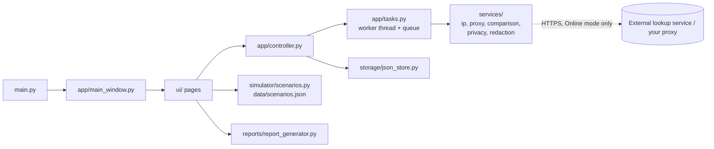

# Anonymity Toolkit

A desktop application (Python + CustomTkinter) for learning about **network privacy, VPNs, proxies and diagnostics**.
It is a cybersecurity student project. It *observes and explains*; it does **not** promise anonymity.

> **Important:** this tool cannot guarantee anonymity, verify every aspect of VPN routing, or detect every privacy leak.
> A changed IP address is not proof of anonymity.

## Problem statement and objectives

People often assume that "using a VPN" or "using a proxy" makes them anonymous. In reality each tool protects some
things and not others. The objectives are to let a user:

1. Observe the public IP address an external lookup service reports.
2. Test an HTTP/HTTPS proxy they own or are authorised to test.
3. Compare observations before and after connecting a VPN or proxy manually.
4. Understand what VPNs and proxies do and do not protect.
5. Review privacy settings with a transparent checklist.
6. Learn through clearly labelled, fully offline simulations.
7. Export a local report with findings, limitations and recommendations.

## Features

| Page | What it does |
|---|---|
| Dashboard | Mode, latest IP observation (marked STALE after 1 hour), last diagnostic time, saved counts, quick actions, local-data location, "Clear saved history". |
| IP Information | Background lookup (api.ipify.org), validated with `ipaddress`, timeouts, friendly errors. Every successful lookup is saved automatically. |
| Proxy Tester | Validates URL/host/port, one HTTPS request through the proxy, separates proxy failures from destination failures, optional credentials kept in memory for one test only. |
| Network Comparison | Compare any two saved observations; careful wording, limitations and follow-up checks. Works offline. |
| Privacy Checklist | 7 manual items with purpose, evidence, status, next step and limitations. Statuses: Reviewed / Needs review / Not verified. No score. |
| Learning Simulator | 7 offline SIMULATED scenarios with traffic-flow diagrams and "who can see what". |
| Reports | TXT or HTML report, optional IP redaction, evidence kinds kept separate, saved where you choose. |
| About / Help | Capabilities, limits, quick start, ethical use, data location. |

Other: Online/Offline mode selector (Offline is the default and makes no network requests), light/dark theme switch
(remembered), JSON storage with validation and corruption recovery, log redaction of secrets.

## Technology stack

Python 3.11+, CustomTkinter 5.2.2, Requests, and the standard library (`json`, `ipaddress`, `threading`, `queue`,
`logging`, `unittest`, `tempfile`, `html`). No database, web framework or browser automation.

## Architecture



Rule of thumb: **GUI code never contains network logic**, and **services never import the GUI**, so all logic is
unit-testable without a display.

## Folder structure

```
anonymity-toolkit/
├── main.py                 # entry point
├── requirements.txt
├── README.md
├── app/                    # controller, tasks, navigation, theme, window, logging
├── ui/                     # one file per page + reusable components
├── services/               # ip, proxy, comparison, privacy, redaction (no GUI imports)
├── simulator/scenarios.py  # loads/validates data/scenarios.json
├── storage/json_store.py   # validated, atomic JSON storage
├── reports/report_generator.py
├── data/scenarios.json     # the 7 offline scenarios
├── docs/                   # manual tests, demo script, concepts, module guide
└── tests/                  # unittest suite (network is always mocked)
```

## Installation

Requires **Python 3.11+** with Tk support.

**Windows**
```powershell
py -3.11 -m venv .venv
.venv\Scripts\activate
pip install -r requirements.txt
```

**Linux** (Debian/Ubuntu shown; Tk is a separate package)
```bash
sudo apt install python3-tk
python3 -m venv .venv
source .venv/bin/activate
pip install -r requirements.txt
```

## Run

```bash
python main.py
```

## Run the tests

```bash
python -m unittest discover -s tests -v
```

The suite mocks all HTTP, so it runs offline and needs no VPN or paid service. `tests/test_gui_smoke.py` opens every
page when a display and CustomTkinter are available, and is skipped otherwise.

## Example usage

1. Switch to **Online** (sidebar) and open **IP Information**; press *Look up my public IP*.
2. Connect your VPN in its own app, then look up again.
3. Open **Network Comparison**, choose the two observations, and read the explanation and limitations.
4. Work through the **Privacy Checklist**; set each item honestly.
5. Explore the **Learning Simulator** (works offline).
6. Open **Reports**, choose options (consider *Redact IP addresses*), preview, and save.

## Screenshots

Replace these placeholders with your own screenshots (save them in `docs/screenshots/`).

| | |
|---|---|
|  |  |
|  |  |
|  |  |

## Known limitations

- Reports one lookup service's view at one moment; the service itself is a third party.
- No DNS-leak, WebRTC, IPv6 or kill-switch testing; the checklist is manual and user-reported.
- Proxy support: `http://` and `https://` proxies only (no SOCKS). One request per test.
- Saved data is plain JSON (not encrypted) in your user folder.
- Simulator scenarios are simplified models; real products differ.
- The automated tests do not exercise the GUI widgets themselves; use `docs/MANUAL_TESTING.md`.

## Privacy and ethical-use statement

Use this tool only on networks, proxies and accounts you **own or are authorised to test**. It has no proxy discovery,
scanning or credential guessing, and never will. No analytics: the only network traffic is the lookup and proxy-test
requests you start in Online mode. Proxy passwords stay in memory for one test and are never saved, logged or
written to reports. Reports and history contain IP addresses; treat them as personal data.

## Future improvements

SOCKS proxy support; optional DNS-leak guidance with user-supplied results; export history to CSV; configurable lookup
service; encrypted local storage; more scenarios; translated interface; screenshot-based user guide.
